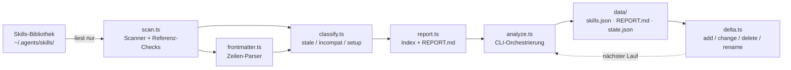

# Architektur: Skills-Manager

Stand: Slice 1 (Analyse-CLI). Die Dokumentation wächst mit jedem Slice.

## Überblick

## Module (Slice 1)

| Modul | Verantwortung | Reine Funktion? |
|-------|---------------|-----------------|
| `types.ts` | Geteilte Typen (`SkillMeta`, `SkillsIndex`, `SkillsState`) | – |
| `frontmatter.ts` | Frontmatter-Zeilen-Parser: quoted/unquoted, mehrzeilig, CRLF, BOM | ja |
| `classify.ts` | Klassifizierung `stale` / `incompat` / `needs-setup` inkl. Risiko-Normalisierung | ja |
| `scan.ts` | Bibliothek scannen: Container rekursiv, Referenz-Existenzchecks, Binär-Erkennung | fs-injiziert über Root |
| `delta.ts` | Delta-Vergleich alter State vs. neuer Scan; Move-Erkennung über Content-Hash | ja |
| `report.ts` | Index-Bau + Markdown-Report (Risiko-Verteilung, Container, Flag-Auszug) | ja |
| `analyze.ts` | CLI-Orchestrierung: laden → scannen → delta → Artefakte schreiben | Einstiegspunkt |

## Datenfluss

1. **Scan**: `scanSkillsRoot(root)` liest jede SKILL.md, erkennt Container-Ordner
   (Ordner mit Sub-Skills statt eigenem SKILL.md) und prüft alle lokalen
   Referenzen (Markdown-Links, Skript-Aufrufe) auf Existenz.
2. **Klassifizieren**: je Skill entstehen Flags mit maschinenlesbaren Gründen.
3. **Delta**: existiert ein State vom vorherigen Lauf mit gleichem Root, werden
   nur Deltas berechnet (`added`/`changed`/`deleted`/`renamed`/`unchanged`).
4. **Artefakte**: Index, Report und State werden nach `src/data/` geschrieben.

## Klassifizierungs-Regeln

| Flag | Auslöser |
|------|----------|
| `stale` | `date_added` älter als 6 Monate **oder** Deprecated-/Superseded-/Archived-/Legacy-Marker im Text |
| `incompat` | fehlende lokale Referenz (`.py`/`.sh`/`.ps1`/`.js`/`.ts`/`.md`) **oder** > 2 % Replacement-Character (Binär-Müll) |
| `needs-setup` | API-Key-/Token-Muster, MCP-Server-Setup, `pip install`, vorhandene `requirements.txt`/`package.json` |

Risiko-Werte werden auf `safe | unknown | critical | offensive | none` normalisiert;
alles andere fällt auf `unknown` zurück.

## Abhängigkeiten

- **Bun ≥ 1.3** als Laufzeit und Testrunner (Node.js ist wegen der
  OpenTUI-Mindestversion 26.4 bewusst kein Ziel).
- **@opentui/core** ist bereits installiert (für Slice 2+); Slice 1 nutzt es nicht.
- Keine YAML-/Markdown-Parsing-Libraries: bewusste Eigenimplementierung, da die
  Frontmatter-Varianten der realen Bibliothek (quoted/unquoted/mehrzeilig/CRLF)
  sonst Nacharbeit erfordern würden.

## Design-Entscheidungen

- **Nur Lesen**: Die Original-Bibliothek wird nie verändert; Schreibzugriffe
  betreffen ausschließlich `skills-manager/src/data/` (gitignored).
- **Injectables Root**: Alle Kernfunktionen nehmen den Skills-Root als Parameter –
  Tests laufen gegen tmp-Fixtures ohne Zugriff auf die echte Bibliothek.
- **Hash vor Mtime**: Der Content-Hash (SHA-256, 16 Zeichen) ist die Wahrheit für
  Deltas; Mtime/Größe sind später nur Beschleunigungs-Heuristik (Slice 6).
- **Move-Erkennung**: Ein neuer Schlüssel mit bekanntem Hash ist ein Rename, kein
  Add – Flags und Klassifizierung bleiben erhalten.

## Geplante Erweiterungen (Issues)

- #3 TUI-Baum (OpenTUI), #4 Multi-Select/Filter/Badges, #5 Install-Flow (Copy-Engine)
- #6 Mirror-Gruppierung (Buckets + routed-Fallback), #7 Delta-Ausbau (Mtime-Heuristik)
- #8 Watcher + Mirror-Sync, #9 semantische Suche via routed, #10 Live-Integration
